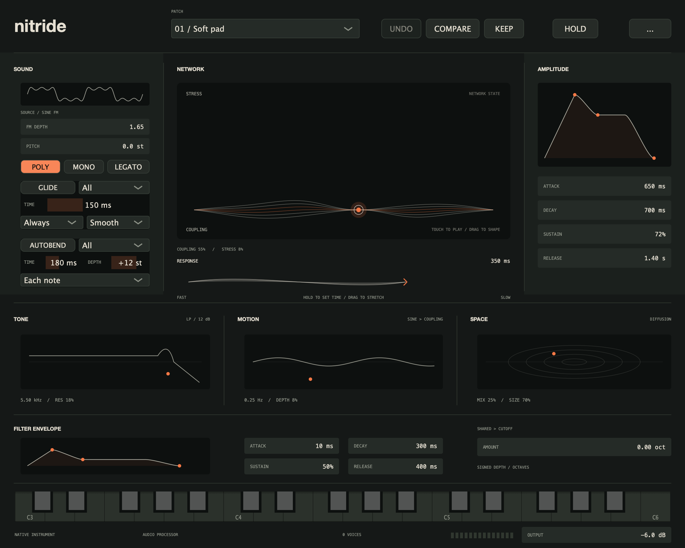

# nitride

A native FM synth experiment for macOS, exploring playable ways to push sounds
from familiar tones into unstable textures.

**Work in progress.** It's playable as a standalone app or an Audio Unit, with
presets and host automation. The sound and interface are still evolving; this
isn't a finished release.



## Try it

Requires macOS 15+ on Apple Silicon, a macOS SDK + Clang, and CMake 3.24+.
The build downloads JUCE automatically.

```sh
make standalone
```

For your DAW, run `make reload-au` to build, install and validate the AU in
`~/Library/Audio/Plug-Ins/Components`. Restart your DAW, then look for **nitride**
as an AU instrument.

## Poke around

- `make studies` — sound experiments and comparisons.
- `make gestures` — the playable control-surface study.
- `make check` — local development checks.
- [Contributing](CONTRIBUTING.md) — build, test and development notes.
- [Architecture](docs/ARCHITECTURE.md) — how the instrument fits together.
- [Design notes](docs/DESIGN.md) — the original brief and evolving direction.
